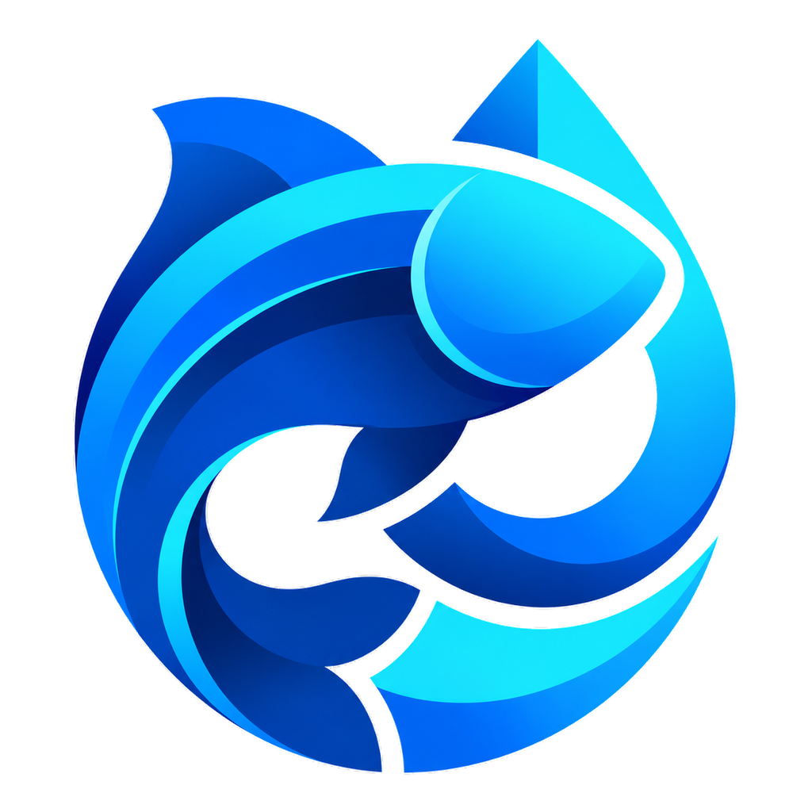

# 🐟 MyFish — Smart IoT Aquarium Auto-Feeder

<p align="center">
  
</p>

<p align="center">
  <strong>Aplikasi Monitoring & Kontrol Pemberi Pakan Ikan Otomatis Berbasis ESP32 & Firebase</strong>
</p>

<p align="center">
  
  
  
  
  
  
  
</p>

---

## 📖 Tentang MyFish

**MyFish** adalah aplikasi mobile Android modern yang dirancang untuk membantu para penghobi ikan hias maupun pembudidaya akuakultur dalam memantau dan mengontrol jadwal pemberian pakan ikan secara otomatis, presisi, dan *real-time*.

Aplikasi ini terhubung langsung dengan perangkat keras mikrokontroler **ESP32** dan motor servo melalui arsitektur cloud **Firebase Authentication** dan **Cloud Firestore**. Dengan desain antarmuka Material 3 yang elegan, responsif, dan mudah digunakan, pengguna dapat memastikan ikan peliharaan mendapatkan nutrisi tepat waktu dari mana saja.

---

## ✨ Fitur Utama

### 1. 📡 Monitoring Status Alat Real-Time
- Indikator koneksi alat ESP32 (*Terhubung* / *Terputus*) dengan deteksi detak jantung (*heartbeat*) 90 detik.
- Menampilkan waktu terakhir perangkat aktif (*last seen*) dan versi firmware yang sedang berjalan.
- Penonaktifan otomatis aksi pakan berisiko saat alat dalam status *offline*.

### 2. ⚡ Pemberian Pakan Manual Cerdas
- Tombol aksi geser (*slide-to-confirm*) untuk mencegah ketidaksengajaan memberi pakan berlebih.
- Pilihan dosis fleksibel mulai dari **Level 1** (paling sedikit) hingga **Level 5** (paling banyak).
- Status perintah dipantau langsung dari *pending* → *running* → *done*.

### 3. ⏰ Penjadwalan Otomatis Fleksibel
- Atur jam pemberian pakan otomatis harian dengan format 24 jam.
- Pengaturan dosis per jadwal independen.
- Saklar (*toggle*) aktif/nonaktif cepat di setiap kartu jadwal.
- Validasi cerdas: mencegah pendaftaran jam pakan ganda yang sama.

### 4. 📊 Riwayat & Analisis Pakan
- Grafik batang aktivitas pakan 7 hari terakhir (*fl_chart*).
- Daftar 5 riwayat pakan terbaru langsung di layar beranda.
- Pencatatan lengkap: jam pemberian pakan, dosis (Level 1–5), metode (*Auto* / *Manual*), dan durasi buka katup servo.
- Kebijakan retensi data otomatis (*Time-To-Live / TTL* 30 hari) di Firestore.

### 5. 🛠️ Kontrol & Kalibrasi Perangkat
- **Kalibrasi Servo Presisi**: Pengaturan durasi buka katup pakan (0.1 s.d. 10.0 detik) per level dosis.
- **Kontrol Jarak Jauh**: Perintah *Reset* (reboot) dan *Shutdown* (deep sleep) ESP32 dari jarak jauh.
- **Keamanan Berlapis**: Aksi berisiko (reset, matikan alat, simpan kalibrasi) dilindungi dengan **re-autentikasi kata sandi** dan tombol konfirmasi geser.

### 6. ♿ Aksesibilitas & Kenyamanan Visual (A11y)
- Mengikuti pedoman **DESIGN.md**: Target sentuh $\ge 48\text{dp}$, kontras warna WCAG AA, dan label semantik pembaca layar (*Semantics*).
- Kompatibel penuh dengan skala teks sistem hingga **200%** tanpa masalah tata letak (*no overflow*).
- Tipografi modern menggunakan *Plus Jakarta Sans*.

---

## 🏗️ Arsitektur & Teknologi

| Lapisan | Teknologi | Deskripsi |
|---|---|---|
| **Frontend Mobile** | Flutter 3.13+, Dart 3.1+ | Aplikasi native Android dengan Material Design 3 |
| **State & Navigation** | Pure Flutter Streams & Navigator | Responsif terhadap perubahan data Firestore *real-time* |
| **Database & Auth** | Firebase Auth & Cloud Firestore | Autentikasi email/password & penyimpanan dokumen cloud |
| **Visualisasi Data** | `fl_chart` | Grafik analitik statistik pakan mingguan |
| **Mikrokontroler** | ESP32 DEVKIT V1 | Mengelola komunikasi WiFi, NTP, dan motor servo |
| **Aktuator** | TowerPro MG90S / SG90 | Penggerak katup pintu dispenser pakan |

---

## 📁 Struktur Direktori

```text
lib/
├── core/                  # Fondasi aplikasi
│   ├── constants/         # Konstanta batas waktu, versi, & teks
│   ├── routing/           # Konfigurasi rute navigasi
│   ├── theme/             # Token warna, tipografi, dan tema Material 3
│   └── utils/             # Format tanggal, waktu, & converter
├── data/                  # Layer data & repositori
│   ├── models/            # Model data: DeviceData, ScheduleItem, HistoryItem
│   ├── auth_repository.dart    # Autentikasi Firebase Auth
│   └── device_repository.dart  # Sinkronisasi Cloud Firestore
├── features/              # Modul fitur per halaman
│   ├── splash/            # Layar pembuka & inisialisasi
│   ├── onboarding/        # Pengenalan fitur aplikasi (3 slide)
│   ├── login/             # Pemilihan alat & login password terenkripsi
│   ├── shell/             # Navigasi utama (Bottom Navigation Bar)
│   ├── home/              # Status alat, grafik pakan, 5 riwayat, aksi manual
│   ├── schedule/          # Manajemen jadwal (tambah, ubah, hapus)
│   ├── history/           # Daftar lengkap riwayat pakan
│   └── settings/          # Kontrol ESP32, kalibrasi, cek update, profil
└── widgets/               # Komponen antarmuka modular yang dapat digunakan ulang
    ├── app_button.dart    # Tombol kustom (Primary, Secondary, Danger, Text)
    ├── app_card.dart      # Kartu berbingkai & berbayang halus
    ├── app_header.dart    # Header konsisten dengan logo & ikon interaktif
    ├── password_field.dart# Kolom input kata sandi dengan toggle visibilitas
    ├── slide_confirm.dart # Tombol geser untuk konfirmasi aksi kritis
    └── state_views.dart   # Tampilan state Loading, Empty, dan Error
```

---

## 🚀 Panduan Memulai (Instalasi & Penggunaan)

### 1. Prasyarat Lingkungan
Pastikan perangkat pengembangan Anda telah terpasang:
- **Flutter SDK**: versi `3.13.0` atau yang lebih baru.
- **Java Development Kit (JDK)**: JDK 17.
- **Android Studio** atau **VS Code** dengan ekstensi Flutter/Dart.

### 2. Kloning Repository
```bash
git clone https://github.com/username/myfish.git
cd myfish
```

### 3. Pasang Dependensi
Unduh seluruh paket yang diperlukan:
```bash
flutter pub get
```

### 4. Konfigurasi Firebase
1. Buat proyek baru di [Firebase Console](https://console.firebase.google.com/).
2. Aktifkan layanan **Authentication** (Metode Email/Password).
3. Aktifkan **Cloud Firestore Database** (Mode Standar).
4. Daftarkan aplikasi Android dengan nama paket `com.myfish.myfish`.
5. Unduh file `google-services.json` dan letakkan di direktori:
   ```text
   android/app/google-services.json
   ```
   *(Contoh format dapat dilihat di `android/app/google-services.json.example`)*

### 5. Menjalankan Aplikasi
Hubungkan perangkat Android Anda via kabel USB atau jalankan emulator, lalu ketik:
```bash
flutter run
```

---

## 🧪 Pengujian & Verifikasi Kualitas Kode

Proyek ini telah dilengkapi dengan rangkaian pengujian komprehensif (Uji Unit, Uji Widget, dan Uji Aksesibilitas):

```bash
# Menjalankan analisis statis Dart (Harus 0 masalah / Clean)
dart analyze

# Menjalankan seluruh pengujian (44 pengujian unit & widget)
flutter test
```

---

## 🔒 Kebijakan Keamanan & Data

1. **Keamanan Autentikasi**: Seluruh kredensial akun alat dilindungi menggunakan standar enkripsi Firebase Authentication.
2. **Isolasi Data Pengguna**: Aturan Cloud Firestore membatasi akses baca dan tulis dokumen hanya untuk pengguna pemilik ID perangkat yang terotentikasi.
3. **Pembersihan Otomatis**: Riwayat pakan secara teratur dibersihkan melalui fitur Cloud Firestore Time-To-Live (TTL) berbasis field `expireAt`.

---

## 📄 Lisensi & Kontribusi

Proyek ini dikembangkan secara independen untuk keperluan pemeliharaan akuarium modern. Silakan ajukan *Issue* atau buat *Pull Request* jika Anda ingin berkontribusi dalam pengembangan aplikasi ini.

Dibuat dengan ❤️ untuk komunitas pecinta ikan & penggemar IoT.
